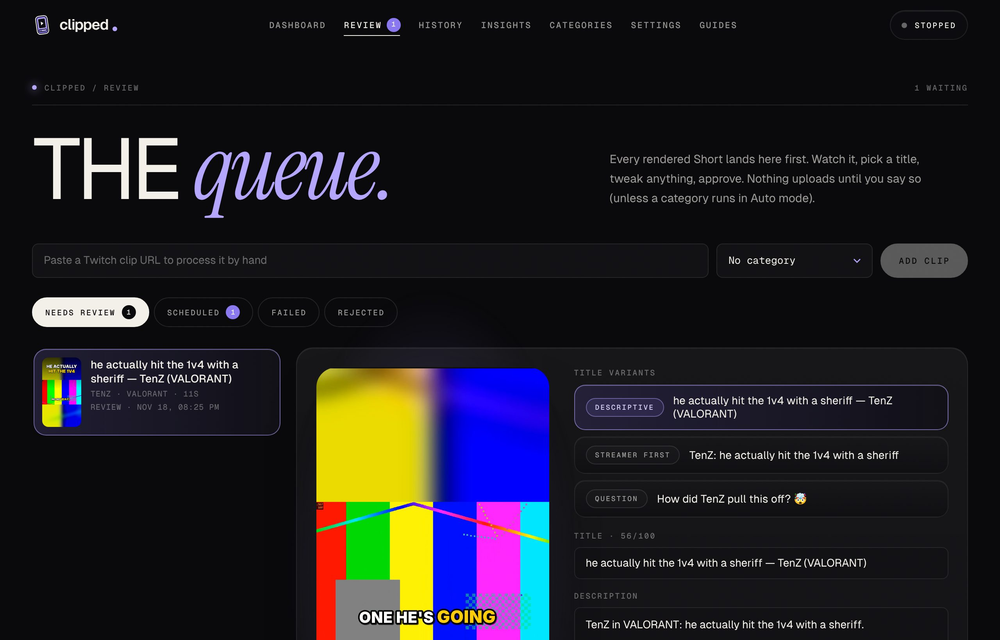

# clipped

**Free, local-first Twitch clips → captioned YouTube Shorts.** clipped finds popular clips in the Twitch categories you choose, turns them into vertical videos with word-by-word burned-in captions, and uploads them to your YouTube channel, either after you approve each one or fully automatically on a schedule.

It runs on **your computer** with **your own API keys**. There is no clipped server and no account. Nothing about you, your keys or your videos is sent anywhere except to Twitch, Google and (optionally) the AI provider you pick.



## Features

* **A real desktop app:** double-click and clipped opens in its own window (no browser tab). Close the window to quit. `clipped shortcut` adds it to your Desktop and Start Menu.
* **Any Twitch category**, such as Valorant, CS2, GTA, Fortnite or Just Chatting. Search and add as many as you like, each with its own minimum views, discovery mode, language, daily limit, streamer allowlist/blocklist, hashtags and manual/auto mode.
* **Trending now or top of the last 24h:** pick how clips are found, globally or per category. *Trending* takes clips from the last few hours that are gaining views fastest right now (view counts are re-checked on every fetch, so a clip that starts blowing up jumps the queue). *Top 24h* takes the most-viewed clips created in the last 24 hours.
* **Full pipeline per clip:** fetch top clips → dedupe (never the same clip twice, nor the same moment clipped by someone else) → download (yt-dlp) → transcribe locally (faster-whisper, word timestamps) → **burned-in captions** (always on: word-level, large bold text, current word highlighted with a pop animation, configurable font/colours/position, kept inside the Shorts safe area) → reframe to 9:16 (blurred-background fill, facecam/gameplay split, or centre crop) → hook → title/description/hashtags → thumbnail → upload.
* **Hooks:** trims dead air, cuts long silences, opens with a short flash-forward to the loudest moment, and shows on-screen hook text for the first 2 seconds.
* **Credit is mandatory:** the streamer's name, a link to their channel, and a link to the original clip are always in the description, and the name goes in the title too. Your edits can't remove them.
* **Manual approval (default):** a review queue with video preview, 2-3 title variants, and editable title, description, hashtags, hook, thumbnail and commentary. Approve, reject or re-render.
* **Auto mode:** upload interval (30 min / 2 h / 6 h / 24 h / custom), daily cap, minimum gap, quiet hours and "pause until". It ranks clips by your discovery mode (current view velocity, or total views for top-24h), ideal length (15-45 s) and hype (audio loudness peaks plus transcript keywords), and skips clips that are too long, too quiet or too similar to recent uploads.
* **Learns from your channel:** stores views and retention for every upload (YouTube Data + Analytics APIs), learns which title style works (Thompson sampling) and which posting hours perform best, then favours them. It also spreads uploads across streamers and categories. A **"What's working"** page shows the results.
* **Dashboard:** big Start/Stop, status, next-upload countdown, live logs, review queue, upload history with YouTube links and stats, and YouTube API quota usage with automatic backoff and pause-until-reset.
* **Safety:** a one-time responsibility notice before Auto mode, "approved streamers only" for Auto mode (on by default), rate limits, and optional intro/outro/commentary so uploads aren't pure reposts.
* **Looks the part:** the dashboard and website share the evzero design language: ink black, warm off-white and one iris accent, Geist / Geist Mono / Instrument Serif type, a welcome curtain, per-letter blur-in titles, cursor-lit glow cards, a warp star field behind the Start button, magnetic buttons, smooth scrolling and a status dock. Everything respects `prefers-reduced-motion`, and fonts are bundled so the local app never calls a font CDN.
* **Private by design:** keys live in the OS keychain (Windows Credential Manager, macOS Keychain, Linux Secret Service), are never logged (a redaction filter scrubs every log line), and are never returned by the local API. The dashboard binds to `127.0.0.1` and rejects cross-site requests.

## Install

### Desktop app (Windows, macOS, Linux)

Download the latest build from the [Releases page](https://github.com/ritviksajeev/clipped/releases/latest) and unzip it. ffmpeg is included.

| OS | File | Run |
| --- | --- | --- |
| Windows 10/11 x64 | `clipped-windows-x64.zip` | double-click `clipped.exe` (SmartScreen: *More info → Run anyway*) |
| macOS Apple Silicon | `clipped-macos-arm64.zip` | right-click `clipped` → *Open* the first time (the build is unsigned) |
| macOS Intel | `clipped-macos-x64.zip` | same as above |
| Linux x64 | `clipped-linux-x64.tar.gz` | `./clipped/clipped` |

clipped opens in its own window. On Windows that is a Microsoft Edge app window (Edge ships with Windows, so nothing else is installed); on macOS a native window; on Linux a Chrome/Chromium/Edge app window, or a browser tab if none is installed. Keep it open while clipped works (auto uploads happen while it runs); close it to quit. `clipped-cli` is the same program with a console, for `clipped-cli doctor` and the other commands below.

### Docker

```bash
git clone https://github.com/ritviksajeev/clipped.git && cd clipped
docker compose up -d --build
# open http://localhost:8000
```

Data and keys live in the `clipped-data` volume. Containers have no OS keychain, so keys are stored in `/data/secrets.json`, readable only by the container user. You can also inject keys as environment variables (`CLIPPED_TWITCH_CLIENT_ID`, `CLIPPED_TWITCH_CLIENT_SECRET`, `CLIPPED_GOOGLE_CLIENT_ID`, `CLIPPED_GOOGLE_CLIENT_SECRET`, `CLIPPED_ANTHROPIC_API_KEY`, `CLIPPED_OPENAI_API_KEY`).

### From source

Requires Python 3.11+, Node 18+ and ffmpeg with libass (Windows: `winget install --id Gyan.FFmpeg -e`, macOS: `brew install ffmpeg`, Linux: `sudo apt install ffmpeg`).

macOS / Linux:

```bash
git clone https://github.com/ritviksajeev/clipped.git && cd clipped
python3 -m venv .venv && source .venv/bin/activate
pip install -e ".[dev]"
(cd frontend && npm ci && npm run build)   # builds the dashboard into clipped/web
clipped doctor                             # checks ffmpeg, libass, keychain, whisper
clipped                                    # opens the clipped app window
clipped shortcut                           # optional: Desktop + app-menu shortcut
```

Windows (Command Prompt), one line at a time:

```bat
git clone https://github.com/ritviksajeev/clipped.git
cd clipped
python -m venv .venv
.venv\Scripts\activate
pip install -e .
cd frontend
npm ci
npm run build
cd ..
clipped doctor
clipped
clipped shortcut
```

`clipped` opens the app window; `clipped shortcut` adds **clipped** to your Desktop and Start Menu so next time you just double-click it. (`clipped serve` still runs it in a normal browser tab at http://localhost:8000.)

In a new terminal, run `.venv\Scripts\activate` (or `source .venv/bin/activate`) again before using `clipped`.

## Setup

The same guides are built into the app (**Guides** in the sidebar) and on the website.

### 1. Twitch Client ID and Secret (free, about 3 minutes)

1. Turn on two-factor authentication: <https://www.twitch.tv/settings/security>.
2. Open <https://dev.twitch.tv/console/apps> → **Register Your Application**.
3. **Name:** something unique (e.g. `clipped-yourname`). **OAuth Redirect URLs:** `https://localhost` (Twitch requires https; clipped never uses it). **Category:** Application Integration. **Client Type:** Confidential. Click **Create**.
4. Click **Manage**, copy the **Client ID**, then click **New Secret** and copy the secret.
5. In clipped: **Settings → Connections → Twitch**, paste both, click **Save**, then **Test Twitch**.

### 2. YouTube via your own Google Cloud project (free, about 10 minutes)

Your Google Cloud project won't be "verified" by Google, and it doesn't need to be for personal use. Two things to know up front:

* **Uploads may be locked to private** until your project passes YouTube's free API audit (step 2.7). clipped detects this and warns you. Until then you can switch videos to Public in YouTube Studio.
* While the OAuth app is in **Testing**, Google expires sign-ins after **7 days**. Publish the app (step 2.3) to avoid that.

1. **Project:** go to <https://console.cloud.google.com/>, sign in with the account that owns your channel, then project picker → **New Project** → name it `clipped` → **Create**, and select it. No billing is needed.
2. **APIs:** in **APIs & Services → Library**, enable **YouTube Data API v3** and **YouTube Analytics API**.
3. **Consent screen** (Google Auth Platform): <https://console.cloud.google.com/auth/overview> → **Get started**. Set app name `clipped`, your support email, Audience **External**, and your contact email, then **Create**. Under **Audience → Test users**, add your Google account. Under **Data Access → Add or remove scopes**, add `youtube.upload`, `youtube.readonly` and `yt-analytics.readonly`, then **Save**. Optionally go to **Audience → Publish app** so sign-ins don't expire after 7 days. The app stays unverified, which is fine for personal use.
4. **OAuth client:** <https://console.cloud.google.com/auth/clients> → **Create client** → type **Desktop app** → **Create** → **Download JSON**.
5. **In clipped:** **Settings → Connections → YouTube**. Paste the downloaded JSON (or the Client ID and Secret) and **Save**.
6. **Connect:** click **Connect YouTube** and pick your channel's account. On "Google hasn't verified this app", choose **Advanced → Go to clipped (unsafe)** (it's your own app), then **Allow**.
7. **Optional, to make API uploads public:** submit the *YouTube API Services - Audit and Quota Extension Form*: <https://support.google.com/youtube/contact/yt_api_form>.

**Quota:** 10,000 units per day, reset at midnight Pacific time. An upload costs about 1,600 units (+50 for a custom thumbnail), so roughly **6 uploads a day**. clipped tracks this, stops before running out, and resumes after the reset. Custom thumbnails need a phone-verified channel (<https://www.youtube.com/verify>).

### 3. Optional: AI titles

Free templates work out of the box. To use AI-written variants, open **Settings → Connections → AI titles** and click one button:

* **Sign in with Anthropic (Claude):** uses the free Anthropic CLI (`ant`). Your browser opens, you approve, and the CLI saves a sign-in that the official Anthropic library refreshes by itself, so clipped never handles a key. This is an Anthropic Console account billed per use (add credit at <https://console.anthropic.com/>). The default model is `claude-opus-5-5`; `claude-haiku-5-5` is the cheapest. clipped requests low effort and structured JSON output, and turns on Anthropic's server-side refusal fallback for models that support it.
* **Connect OpenRouter:** approve clipped on openrouter.ai (OAuth PKCE) and it receives a key made just for clipped, stored in your keychain. One account covers Claude, GPT, Gemini, Llama and free models; the default `openrouter/auto` lets OpenRouter choose.
* **Ollama:** free and local. Install it from <https://ollama.com>, `ollama pull llama3.2`, and clipped detects it.
* **Or paste a key:** Anthropic (`sk-ant-…`) or OpenAI keys still work under *…or paste an API key instead*.

Claude.ai Pro/Max and ChatGPT Plus chat subscriptions can't be used by other apps. If anything fails, clipped falls back to the templates.

### 4. Pick categories and press Start

**Categories** → search → add. Press **Start** on the dashboard, then review and approve clips in **Review**. When you're happy, switch a category (or everything) to **Auto**.

## Command line

```bash
clipped process https://clips.twitch.tv/SomeClipSlug             # one clip end to end, no keys needed
clipped process clip.mp4 --streamer TenZ --streamer-login tenz \
    --title "1v4 clutch" --game VALORANT --clip-url https://clips.twitch.tv/... \
    --layout split --facecam top-right --commentary "watch his crosshair"
clipped process <clip> --upload --privacy unlisted              # also upload (needs Connect YouTube)
clipped                                                          # the app window (same as `clipped app`)
clipped app --window browser                                     # app | native | browser
clipped serve [--port 8000] [--no-browser]                       # dashboard in a browser tab
clipped shortcut                                                 # Desktop / Start Menu / app-menu shortcut
clipped doctor                                                   # environment check
```

`process` writes `short.mp4`, `thumbnail.jpg`, `captions.ass`, `transcript.json` and `metadata.json` to `./clipped-output/<clip>/`. Use `--transcript file.json` to skip whisper, or `--whisper-model small` for better accuracy.

## How the optimiser works

| Lever | Signal | Method |
| --- | --- | --- |
| Which clips | views per hour since creation, clip length, audio loudness bursts, hype keywords in the transcript | weighted score; quiet, long or near-duplicate clips are skipped |
| Variety | streamer and category of recent uploads | multiplicative penalty per repeat in the last N uploads |
| Title style | views + retention of past uploads per style (hype, question, descriptive, streamer-first) | rank-based reward + Thompson sampling, with explicit exploration |
| Posting time | performance by upload hour (your local time) | smoothed hour scores; auto uploads shift later (never earlier than your interval) within a bounded window toward the best hour |
| Hook | loudness envelope + transcript | trim dead air, cut silences, flash-forward to the peak, 2-second hook text |

Learning starts after 6 uploads (titles) and 12 uploads (timing) have been live for at least 24 hours. Both thresholds are configurable under **Settings → Advanced**.

## Privacy & security

* Everything runs locally. The SQLite database, rendered videos and logs live in your user data folder (shown in **Settings → About**), or in `CLIPPED_HOME` if set.
* Keys are stored in the OS keychain. If none is available (headless Linux, Docker), they go in an owner-only file and the dashboard says so. Keys are never logged; known secrets and token-shaped strings are redacted from every log line.
* The local API is write-only for secrets (it returns only "set" plus the last 4 characters), binds to 127.0.0.1, rejects foreign `Host` headers (DNS rebinding), and requires a custom header on every state-changing request (CSRF).
* Network destinations: `api.twitch.tv`, `id.twitch.tv`, Twitch clip CDNs (via yt-dlp), `oauth2.googleapis.com`, `www.googleapis.com`, `youtubeanalytics.googleapis.com`, `huggingface.co` (one-time whisper model download), and `api.anthropic.com` / `api.openai.com` only if you enable AI titles.

## Responsibility

clipped is a tool. You are responsible for having permission to repost streamers' clips and for following the Twitch Terms of Service and YouTube's policies (including the reused-content rules for monetisation). Manual approval is the default, Auto mode requires a one-time acknowledgement, and "approved streamers only" is on by default. See [Auto mode & staying safe](clipped/assets/guides/06-safety.md).

## Development

```
clipped/
  cli.py             command line (app / process / serve / doctor / shortcut)
  desktop.py         app window (Edge/Chrome app mode or pywebview), heartbeat, shortcuts
  server.py          uvicorn launcher (localhost only)
  api/app.py         FastAPI routes + security middleware + serves the dashboard
  engine.py          Start/Stop engine: fetch → render → schedule → upload → stats
  db.py              SQLite (settings, categories, clips, queue, stats, quota)
  keystore.py        OS keychain storage
  logs.py            redacting logger + live log stream
  models.py          pydantic settings/models
  pipeline/          download, audio, transcribe, hooks, captions, render, metadata, thumbnail, runner
  optimizer/         ranking, similarity, learning (bandit, hours, diversity), timing, insights
  services/          twitch.py, youtube.py, quota.py, ai.py (one-click AI connections)
  assets/            fonts (Inter, OFL) and setup guides (Markdown)
frontend/            React + Vite dashboard (builds into clipped/web); src/fx/ holds the motion layer
website/             static landing page + setup guides (GitHub Pages / Netlify)
packaging/           PyInstaller spec + launcher
scripts/             fetch_ffmpeg.py, build_website.py, seed_demo.py
tests/               pytest suite with synthetic media and mocked Twitch/Google HTTP
```

```bash
pytest                                   # ~150 tests, about a minute; needs ffmpeg
cd frontend && npm run dev               # dashboard dev server on :5173 (proxies to clipped serve on :8000)
CLIPPED_HOME=/tmp/demo python scripts/seed_demo.py && CLIPPED_HOME=/tmp/demo clipped serve   # demo data
python scripts/build_website.py          # regenerate website/guides/*.html from the Markdown guides
```

**Desktop builds:** `npm run build` in `frontend/`, then `python scripts/fetch_ffmpeg.py`, then `pyinstaller packaging/clipped.spec`. The `release` GitHub Actions workflow does this for Windows, macOS (arm64 + x64) and Linux whenever a `v*` tag is pushed, and attaches the archives to a GitHub Release.

**Website:** plain HTML/CSS/JS in `website/`. The `pages` workflow publishes it to GitHub Pages. For Netlify, `netlify.toml` already points at `website/`.

## License

MIT, see [LICENSE](LICENSE). The bundled Inter, Geist, Geist Mono and Instrument Serif fonts are under the SIL Open Font License, and Lenis (smooth scrolling) is MIT-licensed (`website/vendor/LICENSE-lenis.txt`). Desktop builds include ffmpeg, which is licensed separately (GPL builds; see <https://ffmpeg.org/legal.html>).
